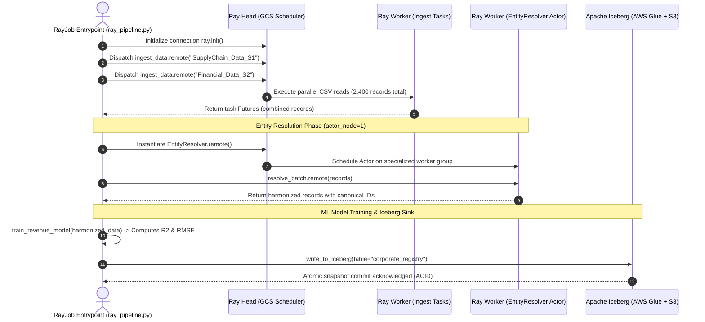
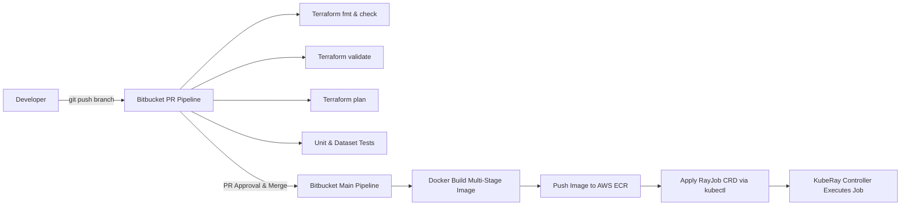

# Distributed AI Foundation: Architectural Specification

> **Deep-Dive Technical Design Document: The Distributed AI Platform**  
> Covers Kubernetes cluster topology, networking, fault tolerance semantics, and CI/CD mechanics.

<!-- # JM Comment: Technical system design and architectural specification -->

---

## 1. Physical Infrastructure Topology

```mermaid
graph TD
    subgraph AWS_Cloud ["AWS Cloud (us-east-1)"]
        subgraph VPC ["VPC (10.0.0.0/16)"]
            subgraph Public_Subnets ["Public Subnets"]
                NAT["NAT Gateway (Outbound Egress)"]
                ALB["AWS Application Load Balancer (Ingress)"]
            end

            subgraph Private_Subnets ["Private Subnets (Zero-Trust Compute)"]
                subgraph NodePool_Head ["EKS Node Pool: On-Demand (m5.xlarge)"]
                    HEAD["Ray Head Pod\n- GCS (Port 6379)\n- Dashboard (Port 8265)\n- Metrics (Port 44217)"]
                end

                subgraph NodePool_Workers ["EKS Node Pool: Spot Auto-scaling (m5, m5a, c5, r5)"]
                    WORKER1["Ray Worker Pod 1\n- Ingestion Tasks\n- /dev/shm (4GiB)"]
                    WORKER2["Ray Worker Pod 2\n- EntityResolver Actor (actor_node=1)\n- ML Trainer"]
                end
            end
        end

        subgraph Storage_Layer ["Data & State Persistence"]
            S3_LAKE["S3: Data Lake & Warehouse"]
            S3_SPILL["S3: Ray Plasma Object Spilling"]
            GLUE["AWS Glue Catalog (Iceberg DB)"]
            KMS["AWS KMS Encryption Key"]
        end

        subgraph IAM_ControlPlane ["Identity Management"]
            OIDC["EKS OIDC Provider"]
            IRSA["Scoped IRSA Role"]
        end
    end

    ALB -->|Port 8265 (HTTPS + Auth)| HEAD
    HEAD <-->|gRPC Mesh & Raylet| WORKER1
    HEAD <-->|gRPC Mesh & Raylet| WORKER2
    WORKER1 -->|Read / Write| S3_LAKE
    WORKER2 -->|Commit ACID Metadata| GLUE
    WORKER1 -.->|Plasma Memory Pressure| S3_SPILL
    OIDC --> IRSA
    IRSA -.->|STS AssumeRole| WORKER1
    IRSA -.->|STS AssumeRole| WORKER2
    NAT --> Private_Subnets
```

---

## 2. Distributed Execution Dataflow (DAG)



---

## 3. Storage Hierarchy & Memory Architecture

```
+-------------------------------------------------------------------------------+
|                             Ray Node Memory Hierarchy                          |
+-------------------------------------------------------------------------------+
|  Level 1: CPU Registers & L1/L2/L3 Cache                                      |
+-------------------------------------------------------------------------------+
|  Level 2: RAM - Process Private Heap (Python Objects, Pandas / Arrow buffers) |
+-------------------------------------------------------------------------------+
|  Level 3: RAM - Plasma Shared Memory (/dev/shm - 4 GiB mounted emptyDir)      |
|           * Zero-copy object sharing between local tasks and actors           |
|           * Managed by Raylet process via Unix domain sockets                 |
+-------------------------------------------------------------------------------+
|  Level 4: Local NVMe / Ephemeral Disk (/tmp/ray/spill)                        |
|           * First-tier spilling when Plasma memory utilization exceeds 80%    |
+-------------------------------------------------------------------------------+
|  Level 5: Remote Object Storage (S3: s3://distributed-ai-lake-d14ec094/ray-spill/) |
|           * Distributed spill target ensuring zero OOM crashes on worker nodes|
+-------------------------------------------------------------------------------+
```

---

## 4. CI/CD Lifecycle Diagram



---
*Created as part of the Distributed AI Foundation Technical Deliverables.*
