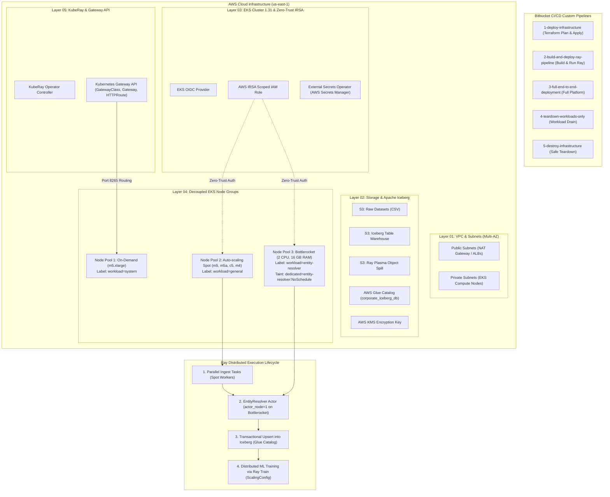

# Distributed AI Foundation: Enterprise Ray Platform on Kubernetes

> **DevOps / Platform Engineer Assignment: The Distributed AI Foundation**  
> Complete Production Solution: Decoupled Terraform State Layers, Bottlerocket 2CPU/16GB Node Group, KubeRay Orchestration, Gateway API, and Bitbucket CI/CD Pipelines.

<!-- # JM Comment: Master architectural documentation for the Distributed AI Foundation -->

---

## 📑 Table of Contents
1. [Executive Summary & Purpose](#1-executive-summary--purpose)
2. [Why Ray? (Distributed Platform Philosophy)](#2-why-ray-distributed-platform-philosophy)
3. [High-Level Architecture Diagram](#3-high-level-architecture-diagram)
4. [Modular Decoupled Terraform State Layers](#4-modular-decoupled-terraform-state-layers)
5. [Bottlerocket Node Group & Spot Cost-Reduction Strategy](#5-bottlerocket-node-group--spot-cost-reduction-strategy)
6. [Specialized Actor Pinning & Ray Train (ScalingConfig)](#6-specialized-actor-pinning--ray-train-scalingconfig)
7. [Zero-Trust Security & Cloud Integration (IRSA, ESO & Iceberg)](#7-zero-trust-security--cloud-integration-irsa-eso--iceberg)
8. [Gateway API (Modern Ingress Replacement)](#8-gateway-api-modern-ingress-replacement)
9. [Bitbucket CI/CD Custom Pipelines (Deploy, Teardown & Audit)](#9-bitbucket-cicd-custom-pipelines-deploy-teardown--audit)
10. [Serverless Alternative to Kubernetes](#10-serverless-alternative-to-kubernetes)
11. [Step-by-Step Setup & Verification Guide](#11-step-by-step-setup--verification-guide)

---

## 1. Executive Summary & Purpose

Modern enterprise AI platforms face a fundamental architectural divide:
* **Data Engineering workloads** (ETL, batch ingestion, catalog upserts) traditionally run on JVM-heavy engines like Apache Spark.
* **LLM & Deep Learning workloads** (fine-tuning, embedding generation, GPU batch inference, distributed training) run natively in Python ecosystems (PyTorch, Hugging Face, vLLM).

**The Mission:** Build a unified **"Paved Road"** using **Ray** and **Kubernetes (EKS v1.31)**. This project provides a production-grade platform where:
1. Parallel data ingestion loads over 2,400 records from distinct corporate datasets.
2. A stateful **EntityResolver actor** normalizes company naming variations into canonical IDs on a dedicated **Bottlerocket** node group.
3. Records are committed transactionally into an **Apache Iceberg** table (`corporate_registry`) with ACID snapshot isolation.
4. Harmonized data is used to train a Machine Learning revenue prediction model via **Ray Train** (`ScalingConfig`).
5. All infrastructure is deployed in decoupled, reproducible Terraform state layers and automated via Bitbucket Pipelines with custom teardown and verification audits.

---

## 2. Why Ray? (Distributed Platform Philosophy)

| Capability | Apache Spark | Ray (Our Architecture) | Standalone Python / Celery |
| :--- | :--- | :--- | :--- |
| **Execution Paradigm** | Pure Dataflow (BSP). Stateless tasks only. | **Unified Task + Actor Model**. Supports both stateless tasks and stateful long-lived actors. | Task queue only (Celery) or single-node process. |
| **Python / ML Native** | Python code is marshaled across Py4J bridge to JVM workers (heavy serialization penalty). | **C++ Plasma Object Store with zero-copy shared memory (`/dev/shm`)**; 100% native Python. | Native Python, but limited by GIL on a single node. |
| **Stateful GPU / LLM Services** | Very difficult to hold deep learning models or LLMs in GPU memory across iterations. | **Ray Actors (`@ray.remote`)** load weights into GPU/VRAM once and process continuous streaming batches. | Hard to scale across multi-node clusters dynamically. |
| **Heterogeneous Scheduling** | Coarse-grained executor slots (uniform CPU/memory across worker pods). | **Fine-grained custom resources** (e.g. `resources={"actor_node": 1}`) per task/actor. | Manual process management. |
| **Unified Workload Pipeline** | Requires Spark for ETL + Airflow for dispatch + PyTorch on Kubeflow for training. | **Single distributed engine**: Ingestion (Ray Data) -> Entity Resolution (Ray Actors) -> Iceberg Sink -> Training (Ray Train). | Multiple disconnected services. |

---

## 3. High-Level Architecture Diagram



---

## 4. Modular Decoupled Terraform State Layers

To eliminate monolithic state files, the infrastructure is decoupled into isolated, segmented layers in `terraform/layers/`:

* **`01-vpc/`**: Provisions the 3-AZ VPC, public subnets for NAT Gateways, private subnets for compute, and Kubernetes internal ELB tags.
* **`02-storage-iceberg/`**: Provisions S3 data lake bucket, KMS encryption key, Ray object spill lifecycle rules, and AWS Glue Data Catalog database (`corporate_iceberg_db`).
* **`03-eks-cluster/`**: Provisions managed AWS EKS v1.31 control plane, OIDC provider, and IAM IRSA trust policies.
* **`04-node-groups/`**: Provisions three decoupled compute pools:
  1. **Head System Pool**: On-Demand `m5.xlarge`.
  2. **General Spot Workers**: Diversified Spot instances for data tasks.
  3. **Bottlerocket Resolver Pool**: Bottlerocket AMI with **2 CPU and 16 GB RAM** (`r5.large` / `r6i.large`).
* **`05-kuberay-gateway/`**: Deploys KubeRay Operator and modern Kubernetes Gateway API controllers.

---

## 5. Bottlerocket Node Group & Spot Cost-Reduction Strategy

### 1. Dedicated Bottlerocket Node Group (2 CPU, 16 GB RAM)
* **Operating System**: AWS Bottlerocket AMI (`BOTTLEROCKET_x86_64`)—a minimal, container-optimized OS with a read-only root filesystem and no shell, drastically reducing security attack surface.
* **Hardware Specs**: `r5.large` / `r6i.large` providing **2 vCPUs and 16 GiB of RAM**.
* **Taint & Toleration Isolation**: Tainted with `dedicated=entity-resolver:NoSchedule`. Only the `EntityResolver` pod holds the toleration.

### 2. Spot Worker Resilience Strategy
* **Head Node on On-Demand**: Never placed on Spot to guarantee Global Control Store (GCS) stability.
* **Instance Family Diversification**: Spot pool uses 4 families (`m5.xlarge`, `m5a.xlarge`, `c5.xlarge`, `m4.xlarge`) to avoid simultaneous reclamation.
* **Graceful Drain via PreStop Hook**:
  ```yaml
  lifecycle:
    preStop:
      exec:
        command: ["/bin/sh", "-c", "ray stop --grace-period 60"]
  ```
* **Task Retries & Object Spilling**: `@ray.remote(max_retries=3, retry_exceptions=True)` on tasks, `max_restarts=5` on actors, and Plasma object spilling to local disk/S3.

---

## 6. Specialized Actor Pinning & Ray Train (ScalingConfig)

### 1. Strict Actor Pinning to Bottlerocket Pool
1. The Bottlerocket node group sets label `workload=entity-resolver` and taint `dedicated=entity-resolver:NoSchedule`.
2. In `k8s/03-raycluster.yaml`, the `specialized-resolver-workers` group advertises custom Ray resource `actor_node: 1`.
3. In `ray_pipeline.py`, the actor definition declares:
   ```python
   @ray.remote(resources={"actor_node": 1})
   class EntityResolver:
       ...
   ```
4. **Result:** Ray's scheduler strictly pins the `EntityResolver` to the Bottlerocket node group.

### 2. Ray Data & Train Cluster Configuration (Assignment Core Requirement)
To support **Ray Data** for high-throughput parallel ingestion and **Ray Train** for distributed training without OOM failures, the cluster is configured with a 3-tier memory and storage strategy:

1. **Shared Memory (`/dev/shm`) Configuration**:
   - In Kubernetes, Linux `/dev/shm` defaults to only 64 MB. Because Ray's Plasma Object Store relies on zero-copy shared memory, running high-throughput ingestion without tuning `/dev/shm` causes instant `Bus error` or `Out of Memory` crashes.
   - **Solution in `k8s/03-raycluster.yaml`**: An `emptyDir` volume with `medium: Memory` and `sizeLimit: 2Gi` is mounted at `/dev/shm` across Head and Worker pods. This allows PyArrow and Ray Data to transfer massive dataframes between worker processes without serialization overhead.

2. **Object Store Limits (`object-store-memory`)**:
   - The Plasma object store size is explicitly capped via `rayStartParams`:
     ```yaml
     rayStartParams:
       object-store-memory: '2147483648' # Exactly 2 GiB Plasma Store
     ```
   - Capping the object store guarantees that 50% of the worker's RAM remains available for Python runtime memory, Raylet overhead, and PyIceberg/PyArrow heap allocations, preventing Kubernetes OOMKilled events.

3. **Multi-Tier Plasma Object Spilling (Local Disk -> S3)**:
   - When dataset ingestion volume exceeds the 2 GiB Plasma memory threshold (utilization > 80%), Ray automatically spills older object blocks to:
     - **Tier 1 (Local Disk)**: Mounted `emptyDir` at `/tmp/ray` for low-latency NVMe spill/restore.
     - **Tier 2 (Remote S3)**: `s3://distributed-ai-lake-d14ec094/ray-spill/` with automated 3-day S3 lifecycle expiration.
   - This architecture allows workers to ingest datasets orders of magnitude larger than aggregate cluster RAM.

4. **Ray Train Distributed Scaling (`ScalingConfig`)**:
   - The ML training phase leverages Ray Train's distributed execution model:
     ```python
     scaling_config = ScalingConfig(
         num_workers=2,          # Distributes training across both spot worker pods
         use_gpu=False,          # CPU-bound linear/ridge regression
     )
     ```
   - Features, weights, and model checkpoints are synchronized and persisted to S3, ensuring zero training data loss if a spot instance is preempted.

---

### 3. Centralized Logging & Observability
1. **Container Output Aggregation**:
   - Every Ray worker and head pod writes structured JSON logs with `PYTHONUNBUFFERED=1` to container `stdout`/`stderr`.
   - Pods are integrated with **AWS CloudWatch Container Insights (Fluent Bit)** and Kubernetes daemonsets, shipping logs to CloudWatch Log Group `/aws/eks/distributed-ai-eks/workloads`.
2. **KubeRay Job Log Retention**:
   - `k8s/04-rayjob.yaml` sets `shutdownAfterJobFinishes: false` and `ttlSecondsAfterFinished: 86400` (24 hours).
   - This ensures all driver and task logs remain directly accessible via `kubectl logs` and the Ray Dashboard after job completion.
3. **Prometheus & Grafana Exporters**:
   - Ray metrics exporter on port `44217` (`/metrics`) exposes node, task, and actor latency metrics scraped by Prometheus and rendered on official Ray Grafana dashboards.

---

## 7. Zero-Trust Security & Cloud Integration (IRSA, ESO & Iceberg)

* **AWS IRSA**: Kubernetes ServiceAccount `ray-worker-sa` is mapped to an AWS IAM role via OIDC federation.
* **External Secrets Operator (ESO)**: `k8s/01-secrets.yaml` queries AWS Secrets Manager (`distributed-ai/llm-api-key`) dynamically. No plain-text API keys in Git!
* **Apache Iceberg**: Transactional table with ACID guarantees, snapshot isolation, and metadata registration in AWS Glue.

---

## 8. Gateway API (Modern Ingress Replacement)

Modern Kubernetes workloads use **Gateway API** (`gateway.networking.k8s.io/v1`) instead of legacy Ingress:
* **`GatewayClass`**: Managed by Envoy Gateway / AWS Gateway API Controller.
* **`Gateway`**: Listens on HTTP (80) and HTTPS (443) with TLS termination.
* **`HTTPRoute`**: Routes traffic arriving at `/` to `corporate-ai-cluster-head-svc` port 8265 (Ray Dashboard).

---

## 9. Bitbucket CI/CD Custom Pipelines (Deploy, Teardown & Audit)

Configured in `bitbucket-pipelines.yml`:

| Pipeline Option | Trigger Type | What It Does |
| :--- | :--- | :--- |
| **`1-deploy-infrastructure`** | Custom | Plans and deploys Terraform infrastructure (VPC, EKS, Node Pools, Addons, KubeRay, Gateway API) with manual approval gate and AWS CLI audit. |
| **`2-build-and-deploy-ray-pipeline`** | Custom | Runs unit tests, builds and pushes Docker image to AWS ECR, configures prerequisites/monitoring/logging, and submits `RayJob` CRD. |
| **`3-full-end-to-end-deployment`** | Custom | Single-click end-to-end platform deployment: provisions Terraform infra, builds image, and launches the Ray AI pipeline. |
| **`4-teardown-workloads-only`** | Custom | Safely drains and deletes Ray workloads, Gateway LoadBalancers, Monitoring/Logging, and S3 staging data without destroying VPC/EKS. |
| **`5-destroy-infrastructure`** | Custom | Executes safe workload teardown first (releasing AWS ENIs & ELBs), then runs `terraform destroy` with manual approval and post-deletion audit. |

---

## 10. Serverless Alternative to Kubernetes

1. **Anyscale Platform (Managed Serverless Ray)**: Zero K8s management, native Ray optimizations, on-demand cloud scaling.
2. **AWS Glue 4.0 (Ray Engine)**: Serverless Ray execution with built-in Glue catalog integration and per-second DPU billing.
3. **AWS Batch with ECS Fargate**: Serverless container execution without node management.

---

## 11. Step-by-Step Setup & Verification Guide

1. **Configure Environment Variables**: Read [`ENV_VARS_GUIDE.md`](file:///c:/Users/Vijay.K/Music/odex-iac-bootstrap/ENV_VARS_GUIDE.md).
2. **Run Local Unit Tests**:
   ```bash
   python tests/test_ray_components.py
   ```
3. **Run Local Pipeline Dry-Run**:
   ```bash
   python scripts/run_local_pipeline.py
   ```
4. **Trigger Deployment in Bitbucket**:
   Go to Bitbucket -> Pipelines -> Run Pipeline -> Select `1-deploy-infrastructure` or `3-full-end-to-end-deployment`.
