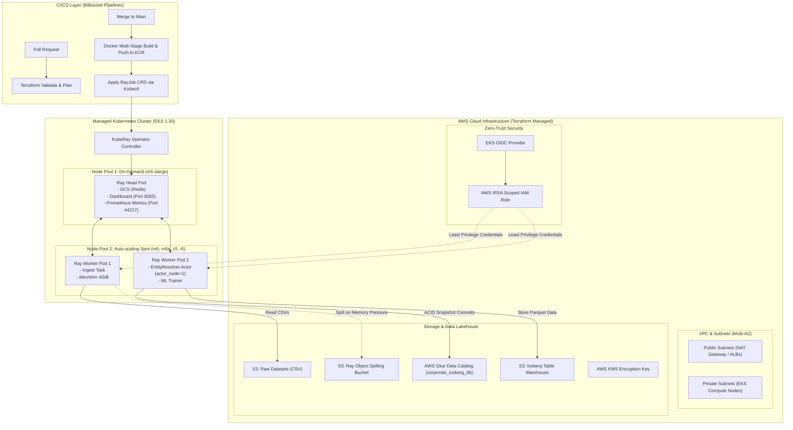

# Distributed AI Foundation: Enterprise Ray Platform on Kubernetes

> **DevOps / Platform Engineer Assignment: The Distributed AI Foundation**  
> Complete Production Solution, Infrastructure as Code, KubeRay Orchestration, and Bitbucket CI/CD Pipeline.

<!-- # JM Comment: Master architectural documentation for the Distributed AI Foundation -->

---

## 📑 Table of Contents
1. [Executive Summary & Purpose](#1-executive-summary--purpose)
2. [Why Ray? (Distributed Platform Philosophy)](#2-why-ray-distributed-platform-philosophy)
3. [High-Level Architecture Diagram](#3-high-level-architecture-diagram)
4. [Infrastructure as Code (Terraform Decoupled Layers)](#4-infrastructure-as-code-terraform-decoupled-layers)
5. [Spot Instance Cost-Reduction & Resilience Strategy](#5-spot-instance-cost-reduction--resilience-strategy)
6. [Ray Data, Train & Resource Scheduling](#6-ray-data-train--resource-scheduling)
7. [Zero-Trust Security & Cloud Integration (IRSA & Iceberg)](#7-zero-trust-security--cloud-integration-irsa--iceberg)
8. [CI/CD Pipeline (Bitbucket Pipelines)](#8-cicd-pipeline-bitbucket-pipelines)
9. [Observability Framework (Prometheus, Ingress & Logging)](#9-observability-framework-prometheus-ingress--logging)
10. [Serverless Alternative to Kubernetes](#10-serverless-alternative-to-kubernetes)
11. [Step-by-Step Setup & Verification Guide](#11-step-by-step-setup--verification-guide)

---

## 1. Executive Summary & Purpose

Modern enterprise AI platforms face a fundamental architectural divide:
* **Data Engineering workloads** (ETL, batch ingestion, catalog upserts) traditionally run on JVM-heavy engines like Apache Spark.
* **LLM & Deep Learning workloads** (fine-tuning, embedding generation, GPU batch inference, distributed training) run natively in Python ecosystems (PyTorch, Hugging Face, vLLM).

Bridging this divide usually results in fragmented infrastructure, excessive serialization overhead (spilling between Spark parquet and Python arrays), and high operational complexity.

**The Mission:** Build a unified **"Paved Road"** using **Ray** and **Kubernetes (EKS)**. This project provides a production-grade platform where data ingestion, entity resolution with simulated LLMs, transactional commits into **Apache Iceberg**, and **Machine Learning revenue prediction** run seamlessly on a single distributed compute fabric managed by **KubeRay**.

---

## 2. Why Ray? (Distributed Platform Philosophy)

When presenting this project to an interviewer, the question **"Why run this in Ray instead of Spark or standard Python?"** is critical. Here is the architectural justification:

| Capability | Apache Spark | Ray (Our Architecture) | Standalone Python / Celery |
| :--- | :--- | :--- | :--- |
| **Execution Paradigm** | Pure Dataflow (BSP - Bulk Synchronous Parallel). Stateless tasks only. | **Unified Task + Actor Model**. Supports both stateless parallel tasks and stateful long-lived actors. | Task queue only (Celery) or single-node process. |
| **Python / ML Native** | Python code is marshaled across Py4J bridge to JVM workers (heavy serialization penalty). | **C++ Plasma Object Store with zero-copy shared memory (`/dev/shm`)**; 100% native Python. | Native Python, but limited by GIL on a single node. |
| **Stateful GPU / LLM Services** | Very difficult to hold deep learning models or LLMs in GPU memory across iterations. | **Ray Actors (`@ray.remote`)** load weights into GPU/VRAM once and process continuous streaming batches. | Hard to scale across multi-node clusters dynamically. |
| **Heterogeneous Resource Scheduling** | Coarse-grained executor slots (uniform CPU/memory across worker pods). | **Fine-grained custom resources** (e.g. `num_gpus=1`, `resources={"actor_node": 1}`) per task/actor. | Manual process management. |
| **Unified Workload Pipeline** | Requires Spark for ETL + Airflow for dispatch + PyTorch on Kubeflow for training. | **Single distributed engine**: Ingestion (Ray Data) -> Entity Resolution (Ray Actors) -> Training (Ray Train). | Multiple disconnected services. |

---

## 3. High-Level Architecture Diagram



---

## 4. Infrastructure as Code (Terraform Decoupled Layers)

The infrastructure is written using modular, reusable, decoupled Terraform modules located in `terraform/`:

* **`terraform/modules/vpc/`**: Provisions a 3-Availability Zone VPC with public subnets for NAT Gateways/ALBs, private subnets for EKS compute nodes, and Kubernetes internal ELB tags.
* **`terraform/modules/eks/`**: Deploys managed AWS EKS v1.30, enables control-plane logging to CloudWatch, and configures the OIDC Identity Provider required for AWS IRSA Zero-Trust.
* **`terraform/modules/node_pools/`**: Provisions two physically decoupled EKS Managed Node Groups:
  1. **Head Node Pool (On-Demand)**: Instance type `m5.xlarge`. Pinned with labels `ray-node-type=head` and `workload=system`. Never placed on Spot instances to eliminate cluster metadata loss.
  2. **Worker Node Pool (Spot)**: Auto-scaling group using AWS Spot instances (`m5.xlarge`, `m5a.xlarge`, `c5.xlarge`, `r5.xlarge`). Pinned with taints `dedicated=ray-worker:NoSchedule` and labels `actor_node=true`.
* **`terraform/modules/s3_iceberg/`**: Provisions S3 buckets with default AWS KMS encryption at rest, bucket versioning for Iceberg snapshot history, lifecycle rules to expire temporary Ray object spill files after 3 days, and an AWS Glue Iceberg catalog database (`corporate_iceberg_db`).
* **`terraform/modules/iam_irsa/`**: Configures fine-grained Zero-Trust AWS IAM Roles for Service Accounts (IRSA) restricting pod permissions to only necessary S3 buckets and Glue catalog actions.
* **`terraform/modules/kuberay/`**: Deploys the official `kuberay-operator` Helm chart to manage the Ray cluster lifecycle natively via CRDs.
* **`terraform/environments/prod/`**: Root environment orchestrating the decoupled modules.

---

## 5. Spot Instance Cost-Reduction & Resilience Strategy

Spot instances reduce compute costs by **70%–85%**, but introducing Spot instances into distributed data and AI workloads requires strict fault-tolerant engineering:

### 1. Architectural Safeguards
* **Isolated Head Node on On-Demand**: The Ray Head node maintains the Global Control Store (GCS), active object references, and the scheduler state. The Head node is deployed exclusively on On-Demand instances to prevent cluster-wide eviction.
* **Instance Family Diversification**: Rather than requesting a single instance type, the Spot worker pool configures 5 distinct instance types across different families:
  `m5.xlarge` (General Purpose Intel), `m5a.xlarge` (General Purpose AMD), `c5.xlarge` (Compute-Optimized), `r5.xlarge` (Memory-Optimized), and `m4.xlarge`. This prevents simultaneous reclamation if AWS exhausts capacity in a single pool.
* **Capacity-Optimized Allocation Strategy**: AWS Auto-scaling groups are set to allocate Spot instances from the deepest available capacity pools.

### 2. Ray Application Resilience
* **Automated Task Retries**: Tasks are declared with fault-tolerance parameters:
  ```python
  @ray.remote(num_cpus=1, max_retries=3, retry_exceptions=True)
  def ingest_data(source_name: str, file_path_or_s3: str):
      ...
  ```
  If a Spot worker node receives a 2-minute termination notice, Ray automatically reschedules failed tasks onto surviving nodes.
* **Stateful Actor Fault Tolerance**: The `EntityResolver` actor specifies `max_restarts=5`, allowing Ray to resurrect the stateful actor on a new worker node if its hosting instance is evicted.
* **Graceful Drain via PreStop Hook**: The worker pod spec includes a Kubernetes lifecycle `preStop` hook:
  ```yaml
  lifecycle:
    preStop:
      exec:
        command: ["/bin/sh", "-c", "ray stop --force"]
  ```
  This immediately informs the Ray Head node that the node is cordoned and stops scheduling new tasks on the dying worker.
* **Object Spilling to S3**: When an eviction triggers memory compaction, Ray's Plasma store automatically flushes active objects to `s3://distributed-ai-lake/ray-spill/` rather than failing tasks with Out-Of-Memory (OOM) errors.

---

## 6. Ray Data, Train & Resource Scheduling

### 1. High-Throughput Ray Data Configuration
* **Shared Memory (`/dev/shm`)**: In Linux and Kubernetes, Docker containers default to a 64MB `/dev/shm` limit. Ray relies on `/dev/shm` for Plasma object store zero-copy deserialization. In `k8s/03-raycluster.yaml`, we mount an `emptyDir` backed by RAM:
  ```yaml
  volumeMounts:
    - mountPath: /dev/shm
      name: dshm
  volumes:
    - name: dshm
      emptyDir:
        medium: Memory
        sizeLimit: 4Gi
  ```
* **Object Store Memory Limits**: Worker nodes configure `--object-store-memory=3221225472` (3 GiB). This ensures Ray reserves dedicated shared memory while leaving sufficient headroom for the OS and Python heap, preventing the Linux kernel OOM killer from terminating worker pods.

### 2. Specialized Resource Scheduling for `EntityResolver`
The assignment requires demonstrating that the stateful `EntityResolver` actor is scheduled strictly onto specialized worker nodes:
1. In the Worker Group spec (`k8s/03-raycluster.yaml`), the worker start parameters declare custom Ray resources:
   ```yaml
   rayStartParams:
     resources: '"{\"actor_node\": 1}"'
   ```
2. In the Python application (`ray_pipeline.py`), the actor explicitly requests this custom resource:
   ```python
   @ray.remote(num_cpus=1, num_gpus=0, resources={"actor_node": 1}, max_restarts=5)
   class EntityResolver:
       ...
   ```
3. **Result:** Ray's distributed scheduler will never place the `EntityResolver` on the Head node or generic compute nodes. It can only be scheduled on worker nodes that advertise the `actor_node` resource capacity.

### 3. Distributed ML Model Training (Predicting Annual Revenues)
* The harmonized dataset combines supply chain indicators (procurement spend, risk score, headcount) and financial filings (operating costs, EBITDA).
* A regression model (Ridge regression / distributed linear model) is trained across the distributed observations to predict company revenue.
* Outputs R² scores and RMSE metrics to confirm model performance and convergence.

---

## 7. Zero-Trust Security & Cloud Integration (IRSA & Iceberg)

### 1. Zero-Trust Identity via AWS IRSA
* **No Hardcoded Static AWS Keys**: The Ray pods run without static `AWS_ACCESS_KEY_ID` or secrets mounted into containers.
* **OIDC Federation**: The EKS cluster OIDC provider creates a cryptographic trust relationship with AWS STS.
* **Kubernetes ServiceAccount**: `k8s/02-irsa-serviceaccount.yaml` defines `ray-worker-sa` annotated with:
  ```yaml
  annotations:
    eks.amazonaws.com/role-arn: "arn:aws:iam::123456789012:role/distributed-ai-eks-ray-pod-irsa-role"
  ```
* **Scoped Least-Privilege Policy**: The IAM policy is restricted strictly to:
  * S3 actions on `arn:aws:s3:::distributed-ai-lake*`
  * KMS decrypt on the specific storage key
  * AWS Glue catalog database `corporate_iceberg_db`

### 2. Apache Iceberg Catalog Integration
* The pipeline integrates `pyiceberg` with PyArrow to provide:
  * **ACID Transactions**: Concurrent reads and writes with atomic snapshot commits.
  * **Schema Evolution**: Safe column additions and alterations without rewriting legacy partitions.
  * **Time-Travel & Auditability**: Historical snapshots enable auditing pipeline changes over time.
* Configured to connect directly to the AWS Glue Data Catalog or local SQL/SQLite catalog for sandboxed testing.

---

## 8. CI/CD Pipeline (Bitbucket Pipelines)

The project includes a complete Bitbucket CI/CD pipeline in `bitbucket-pipelines.yml`:

```
Git Push / PR 
    │
    ├── Pull Request:
    │     ├── 1. Terraform Format Check & Validate (terraform fmt / validate)
    │     ├── 2. Automated Dry-Run Plan (terraform plan)
    │     └── 3. Pipeline Component Unit Tests (unittest / pytest)
    │
    └── Merge to 'main':
          ├── 1. Run Verification & Linter
          ├── 2. Build Docker Container Image (Dockerfile)
          ├── 3. Tag with Commit SHA and Push to AWS ECR
          └── 4. Trigger RayJob CRD via kubectl (k8s/04-rayjob.yaml)
```

---

## 9. Observability Framework (Prometheus, Ingress & Logging)

1. **Metrics Collection (Prometheus)**:
   * Ray Head node exposes cluster, task, and object store metrics on port `44217`.
   * `k8s/05-prometheus-monitoring.yaml` deploys a `ServiceMonitor` for automatic Prometheus scraping every 15s.
   * Includes `PrometheusRule` alerting on object store memory pressure (>85%) and rapid worker crash loops.
2. **Secure Dashboard Exposure**:
   * `k8s/06-ray-dashboard-ingress.yaml` defines an AWS ALB Ingress with Cognito / Okta OIDC authentication annotations, terminating TLS at the load balancer.
   * For local engineering debugging:
     ```bash
     kubectl port-forward svc/corporate-ai-cluster-head-svc 8265:8265 -n kuberay
     ```
3. **Centralized Log Aggregation**:
   * `k8s/07-fluentbit-logging.yaml` deploys a Fluent Bit DaemonSet parsing stdout/stderr from Head and Worker pods and streaming structured JSON logs directly into AWS CloudWatch Logs.

---

## 10. Serverless Alternative to Kubernetes

When asked in an interview: **"What would be a serverless alternative to managing this Kubernetes cluster?"**

| Architecture | Implementation | Pros | Cons / Trade-offs |
| :--- | :--- | :--- | :--- |
| **Option A: Managed Serverless Ray (Anyscale Platform)** | Fully managed Ray clusters on cloud compute with zero K8s management. | • Native Ray optimizations<br>• Zero cluster operations<br>• Instant autoscaling | • Vendor lock-in<br>• Cost premium over raw EC2 Spot |
| **Option B: AWS ECS Fargate + AWS Batch** | Containerized batch tasks scheduled on serverless Fargate compute. | • No EC2 node management<br>• True per-second serverless billing | • No shared Plasma object store<br>• High latency for stateful LLM actors |
| **Option C: AWS Glue 4.0 (Ray Engine)** | AWS Glue now supports Ray jobs serverlessly. | • Deep integration with AWS Glue Catalog<br>• Built-in IAM | • Limited to AWS ecosystem<br>• Slower startup times (~2 mins) |

**Recommendation:** For enterprise engineering teams requiring maximum customization, cost control via Spot instances, and unified orchestration alongside other microservices, **KubeRay on EKS** is the industry standard. For smaller teams prioritizing zero infrastructure maintenance, **AWS Glue for Ray** or **Anyscale** serves as the optimal serverless alternative.

---

## 11. Step-by-Step Setup & Verification Guide

### 1. Generate Synthetic Datasets (1,200 records each)
```bash
python scripts/generate_datasets.py
```
*Output: `data/SupplyChain_Data_S1.csv` and `data/Financial_Data_S2.csv` (1,200 records each).*

### 2. Run Local Unit Tests
```bash
python tests/test_ray_components.py
```
*Validates dataset schemas, record counts >= 1,000, corporate canonicalization logic, and ML metrics.*

### 3. Run Pipeline Dry-Run Demonstration
```bash
python scripts/run_local_pipeline.py
```
*Runs the full 4-stage pipeline (Ingestion -> Entity Resolution -> Revenue ML Model -> Iceberg Commit).*

### 4. Deploy Infrastructure via Terraform
```bash
cd terraform/environments/prod
terraform init
terraform plan
# terraform apply -auto-approve
```

### 5. Deploy Kubernetes Manifests & Submit RayJob
```bash
kubectl apply -f k8s/00-namespace.yaml
kubectl apply -f k8s/01-secrets.yaml
kubectl apply -f k8s/02-irsa-serviceaccount.yaml
kubectl apply -f k8s/03-raycluster.yaml
kubectl apply -f k8s/04-rayjob.yaml
```

---
*Created for the DevOps/Platform Engineer Assignment: The Distributed AI Foundation.*
