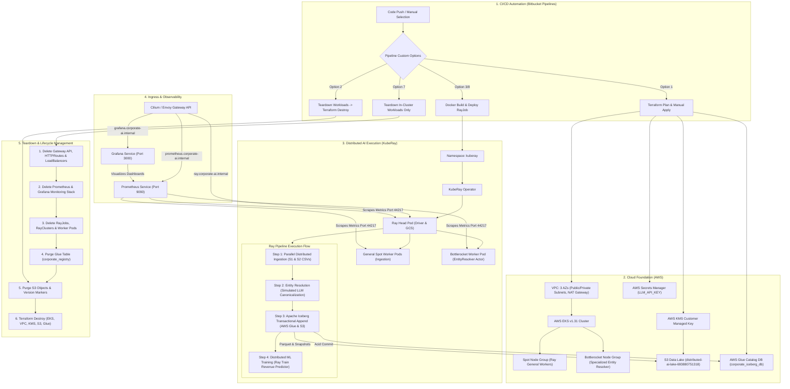

# Distributed AI & Data Lake Infrastructure: Project Workflow & Resource Guide

> [!NOTE]
> This document provides an end-to-end breakdown of the **Distributed AI Foundation Platform** on AWS EKS with KubeRay, Cilium/Envoy Gateway API, Apache Iceberg (AWS Glue & S3), Prometheus, and Grafana. It is designed to be easily understood by DevOps, Cloud Architects, and Data Engineers.

---

## 1. High-Level Architecture & Workflow Diagram



---

## 2. End-to-End Workflow Stages

### Stage 1: Infrastructure Provisioning (Terraform / IaC)
1. **Network Layer**: A production VPC with public and private subnets across 3 Availability Zones (`us-east-1a`, `us-east-1b`, `us-east-1c`) with NAT Gateways for secure egress.
2. **Compute Layer**: Amazon EKS v1.31 cluster with:
   - **System/Head Node Group**: `m5.large` instances for Kubernetes system pods and KubeRay Head.
   - **General Spot Worker Node Group**: Cost-optimized `m5.xlarge` / `c5.xlarge` spot instances labeled `ray-node-type: worker`.
   - **Bottlerocket Specialized Node Group**: Hardened, security-focused AWS Bottlerocket OS instances tainted `dedicated=entity-resolver:NoSchedule` for isolated LLM entity resolution tasks.
3. **Storage & Data Lake**:
   - Customer-managed AWS KMS Key with automated 365-day rotation.
   - S3 Bucket `distributed-ai-lake-693880751318` with AES256/KMS default encryption, public access block, and Ray spill object lifecycle rules.
   - AWS Glue Data Catalog database `corporate_iceberg_db` for metadata management.
4. **Security & Identity**:
   - AWS Secrets Manager storing sensitive API keys (`LLM_API_KEY`).
   - IAM Roles for Service Accounts (IRSA) giving fine-grained, Zero-Trust AWS access to Ray Head, Ray Workers, and Prometheus without storing long-lived AWS keys in containers.

---

### Stage 2: In-Cluster Configuration & Gateway Ingress
1. **CRD Deployments**:
   - Gateway API Standard CRDs (`v1.1.0`): `GatewayClass`, `Gateway`, `HTTPRoute`, `ReferenceGrant`.
   - KubeRay Operator CRDs (`v1.1.1`): `RayCluster`, `RayJob`, `RayService`.
   - Secrets Store CSI Driver CRDs and AWS Provider.
2. **Gateway API Routing** ([k8s/06-gateway-api.yaml](file:///c:/Users/Vijay.K/Music/odex-iac-bootstrap/k8s/06-gateway-api.yaml)):
   - Provisions a single cloud `Gateway` (`ray-dashboard-gateway`) listening on HTTP 80 and HTTPS 443.
   - Host-based routing separates traffic cleanly:
     - `ray.corporate-ai.internal` &rarr; Ray Dashboard (`corporate-ai-cluster-head-svc:8265`)
     - `grafana.corporate-ai.internal` &rarr; Grafana UI (`grafana.monitoring.svc:3000`)
     - `prometheus.corporate-ai.internal` &rarr; Prometheus UI (`prometheus.monitoring.svc:9090`)
     - Default Fallback Route &rarr; Routes root/direct ELB IP traffic directly to the Ray Dashboard.
   - A `ReferenceGrant` in the `monitoring` namespace securely allows cross-namespace routing from the `kuberay` Gateway.

---

### Stage 3: Distributed Ray AI Pipeline Execution
The pipeline ([ray_pipeline.py](file:///c:/Users/Vijay.K/Music/odex-iac-bootstrap/ray_pipeline.py)) coordinates 4 distributed phases across the Ray cluster:

1. **Step 1: Parallel Distributed Ingestion**:
   - Head node dispatches parallel remote Ray tasks (`@ray.remote`) across general spot worker nodes.
   - Simultaneously ingests supply chain records (`SupplyChain_Data_S1.csv`) and financial records (`Financial_Data_S2.csv`).
2. **Step 2: Entity Resolution (Specialized Bottlerocket Node Pool)**:
   - Dispatches batched corporate records to a Ray stateful Actor (`EntityResolver`) scheduled strictly on the specialized Bottlerocket worker pool via custom Ray resource tags (`actor_node: 1`).
   - Resolves variations (e.g. *"Acme Corp Logistics Ltd"* vs *"ACME Global Logistics - Division"*) into canonical IDs (`CORP-UID-xxxxx`) and canonical names.
3. **Step 3: Transactional Apache Iceberg Commit**:
   - PyIceberg connects directly to AWS Glue Data Catalog (`corporate_iceberg_db`).
   - Upserts harmonized PyArrow records into table `corporate_registry`.
   - Commits transactional snapshots (`snapshot-id`) and writes Parquet data files into `s3://distributed-ai-lake-693880751318/iceberg-warehouse/corporate_iceberg_db.db/corporate_registry/`.
   - ACID snapshot isolation guarantees no training job reads corrupted or partial data.
4. **Step 4: Distributed ML Training (Ray Train)**:
   - Configures a distributed `ScalingConfig(num_workers=2)` using Ray Train.
   - Trains an ML revenue predictor (Ridge Regressor) on harmonized Iceberg data, outputting evaluation metrics ($R^2$, RMSE) and persisting model checkpoints.

---

### Stage 4: Observability & Monitoring
- **Ray Metrics Exporter**: Every head and worker pod exposes Ray Prometheus metrics on port `44217` (`/metrics`).
- **Prometheus Deployment** ([k8s/07-monitoring.yaml](file:///c:/Users/Vijay.K/Music/odex-iac-bootstrap/k8s/07-monitoring.yaml)): Automatically scrapes all Ray pods via Kubernetes Pod discovery annotations.
- **Grafana Visualization**: Pre-configured with official Ray dashboards:
  - Default Ray Dashboard (`/d/ray-default-dashboard`)
  - Ray Data Dashboard (`/d/ray-data-dashboard`)
  - Ray Cluster Metrics (`/d/ray-cluster-metrics`)

---

### Stage 5: Teardown & Lifecycle Management
To prevent resource leaks, orphaned Elastic Network Interfaces (ENIs), or Terraform destroy failures due to non-empty S3 buckets or Glue catalogs, the teardown stage executes an orderly sequence:
1. **Delete Gateway API & LoadBalancers**: Frees AWS Network/Application Load Balancers and releases AWS ENIs.
2. **Delete Monitoring & Ray Workloads**: Removes Grafana, Prometheus, RayJob, and RayCluster pods.
3. **Purge AWS Glue Catalog Tables**: Deletes table `corporate_registry` from `corporate_iceberg_db` so Glue database deletion succeeds.
4. **Purge S3 Bucket Objects & Versions**: Deletes all active objects, previous versions, and delete markers from `distributed-ai-lake-693880751318`.
5. **Terraform Destroy**: Deletes the EKS cluster, node groups, KMS key, S3 bucket, Glue database, and VPC.

---

## 3. Manual Resources Checklist (If Creating Without Terraform)

If you need to create the environment manually via the AWS Console / AWS CLI / `kubectl`, follow this comprehensive checklist:

### A. AWS Cloud Resources Checklist

| Resource Type | Resource Name | Key Configuration / Parameters |
| :--- | :--- | :--- |
| **VPC** | `distributed-ai-eks-vpc` | CIDR `10.0.0.0/16`, DNS resolution enabled, DNS hostnames enabled. |
| **Subnets** | 3 Public + 3 Private | Public: `10.0.1.0/24`, `10.0.2.0/24`, `10.0.3.0/24`<br>Private: `10.0.10.0/24`, `10.0.11.0/24`, `10.0.12.0/24` across 3 AZs. |
| **Internet Gateway** | `distributed-ai-eks-igw` | Attached to VPC. Route `0.0.0.0/0` in Public Route Table. |
| **NAT Gateway** | `distributed-ai-eks-nat` | Elastic IP attached. Route `0.0.0.0/0` in Private Route Tables. |
| **KMS Key** | `alias/distributed-ai-key` | Symmetric encryption key with automatic rotation enabled. |
| **S3 Bucket** | `distributed-ai-lake-693880751318` | Region `us-east-1`. Block all public access: ON. Default encryption: AWS KMS. Versioning: Enabled. |
| **Glue Database** | `corporate_iceberg_db` | Parameters: `classification=iceberg`. Region: `us-east-1`. |
| **Secrets Manager** | `ray-llm-secret` | Key-value secret containing `LLM_API_KEY`. |
| **IAM Role (EKS)** | `distributed-ai-eks-cluster-role` | Policy: `AmazonEKSClusterPolicy`. |
| **IAM Role (Nodes)** | `distributed-ai-eks-nodegroup-role` | Policies: `AmazonEKSWorkerNodePolicy`, `AmazonEKS_CNI_Policy`, `AmazonEC2ContainerRegistryReadOnly`. |
| **IAM Role (Ray IRSA)**| `ray-workload-role` | Trust relationship with EKS OIDC provider. Policies: S3 Full Access (on `distributed-ai-lake-*`), AWS Glue Catalog Access. |
| **EKS Cluster** | `distributed-ai-eks` | Kubernetes v1.31, private + public endpoint, VPC private subnets. |
| **Node Group 1 (System)**| `system-head-pool` | Instance type `m5.large`, scaling 1-3. |
| **Node Group 2 (Spot)**| `ray-spot-pool` | Instance types `m5.xlarge`, `c5.xlarge` (Spot), label `ray-node-type=worker`. |
| **Node Group 3 (Resolver)**| `bottlerocket-resolver-pool` | Bottlerocket OS, instance type `m5.xlarge`, taint `dedicated=entity-resolver:NoSchedule`. |
| **EKS Add-ons** | Core EKS Addons | `coredns`, `kube-proxy`, `vpc-cni`, `aws-ebs-csi-driver`, `metrics-server`. |

---

### B. Kubernetes In-Cluster Resources Checklist

Execute these in order using `kubectl`:

```bash
# 1. Install Gateway API CRDs
kubectl apply -f https://github.com/kubernetes-sigs/gateway-api/releases/download/v1.1.0/standard-install.yaml

# 2. Install KubeRay Operator CRDs & Controller
kubectl apply -k "github.com/ray-project/kuberay/ray-operator/config/crd?ref=v1.1.1"

# 3. Install Secrets Store CSI Driver & AWS Provider
kubectl apply -f https://raw.githubusercontent.com/kubernetes-sigs/secrets-store-csi-driver/main/charts/secrets-store-csi-driver/crds/secrets-store.csi.x-k8s.io_secretproviderclasses.yaml
kubectl apply -f https://raw.githubusercontent.com/kubernetes-sigs/secrets-store-csi-driver/main/charts/secrets-store-csi-driver/crds/secrets-store.csi.x-k8s.io_secretproviderclasspodstatuses.yaml
kubectl apply -f https://raw.githubusercontent.com/aws/secrets-store-csi-driver-provider-aws/main/deployment/aws-provider-installer.yaml

# 4. Create Namespaces
kubectl apply -f k8s/00-namespace.yaml

# 5. Create Secrets & SecretProviderClass
kubectl apply -f k8s/01-secrets.yaml

# 6. Create IRSA Service Accounts (bound to AWS IAM Roles)
kubectl apply -f k8s/02-irsa-serviceaccount.yaml

# 7. Provision Ray Cluster (Head + General Spot Workers + Bottlerocket Worker)
kubectl apply -f k8s/03-raycluster.yaml

# 8. Deploy Gateway API (GatewayClass, Gateway, ReferenceGrant, HTTPRoutes)
kubectl apply -f k8s/06-gateway-api.yaml

# 9. Deploy Monitoring Stack (Prometheus & Grafana with Ray Dashboards)
kubectl apply -f k8s/07-monitoring.yaml

# 10. Submit RayJob
kubectl apply -f k8s/04-rayjob.yaml
```

---

## 4. Verification & Operational Health Check

### 1. Verify EKS Nodes & Pods
```bash
kubectl get nodes -o wide
kubectl get pods -n kuberay -o wide
kubectl get pods -n monitoring
```

### 2. Verify AWS Glue Catalog Table
```bash
aws glue get-table --database-name corporate_iceberg_db --name corporate_registry --region us-east-1
```
*Expected Output:* `TableType: EXTERNAL_TABLE`, `Parameters.table_type: ICEBERG`, pointing to `s3://distributed-ai-lake-693880751318/iceberg-warehouse/...`.

### 3. Verify S3 Parquet & Metadata Files
```bash
aws s3 ls s3://distributed-ai-lake-693880751318/iceberg-warehouse/corporate_iceberg_db.db/corporate_registry/ --recursive
```
*Expected Output:* Parquet data files under `data/` and Iceberg snapshot metadata (`.metadata.json`, `.avro`) under `metadata/`.

### 4. Access UIs via Port-Forwarding (Local Access)
If Gateway DNS is not mapped in your local hosts file:
```bash
# Ray Dashboard
kubectl port-forward svc/corporate-ai-cluster-head-svc -n kuberay 8265:8265

# Grafana Dashboard (Credentials: admin / admin123)
kubectl port-forward svc/grafana -n monitoring 3000:3000

# Prometheus UI
kubectl port-forward svc/prometheus -n monitoring 9090:9090
```

---

## 5. Teardown Instructions

### In-Cluster Teardown (Keep VPC & EKS Intact)
Run Bitbucket custom pipeline `7-teardown-eks-workloads-only` or execute:
```bash
kubectl delete httproute,gateway,gatewayclass --all -A --ignore-not-found=true
kubectl delete svc --all-namespaces --field-selector spec.type=LoadBalancer
kubectl delete -f k8s/07-monitoring.yaml --ignore-not-found=true
kubectl delete namespace monitoring --ignore-not-found=true
kubectl delete -f k8s/04-rayjob.yaml -f k8s/03-raycluster.yaml --ignore-not-found=true
kubectl delete namespace kuberay --ignore-not-found=true
```

### Full Infrastructure Destruction (Terraform Destroy)
Run Bitbucket custom pipeline `2-terraform-destroy-infra` or execute:
```bash
# 1. Clean workloads
# 2. Delete Glue tables
aws glue delete-table --database-name corporate_iceberg_db --name corporate_registry --region us-east-1 || true

# 3. Empty S3 Bucket (all objects, versions, and delete markers)
aws s3 rm s3://distributed-ai-lake-693880751318 --recursive || true

# 4. Terraform destroy
cd terraform/environments/prod
terraform init
terraform destroy -auto-approve
```
